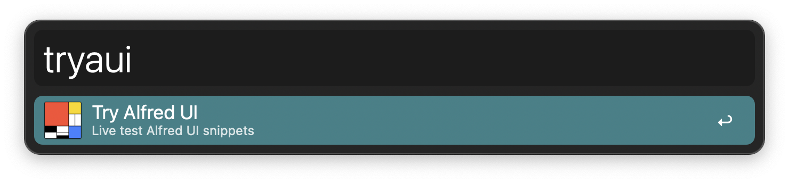
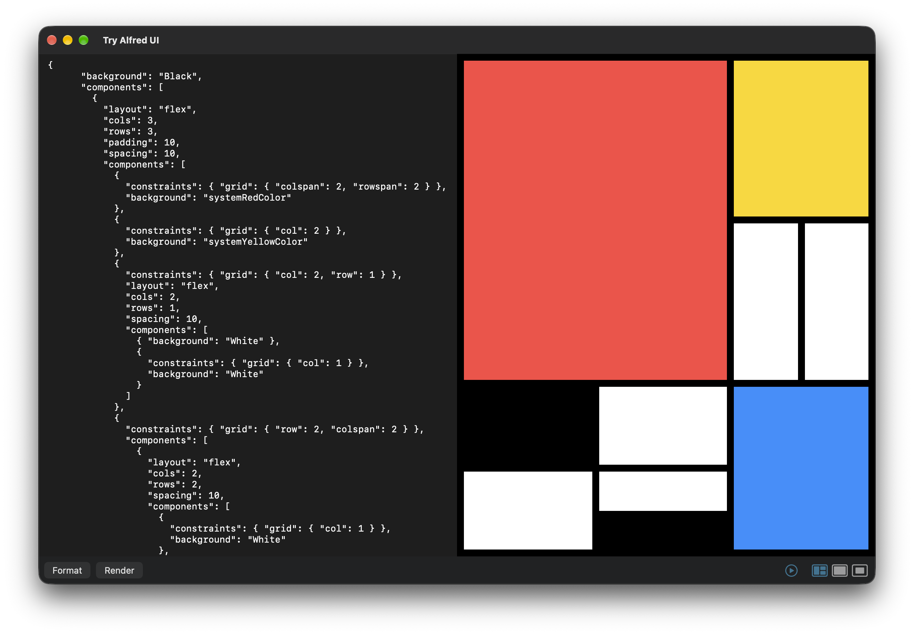
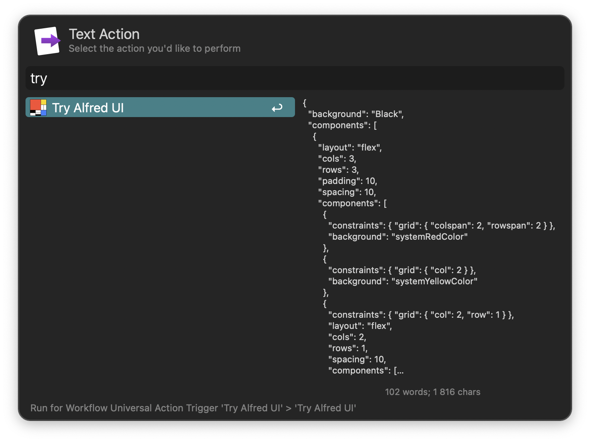

#  Try Alfred UI Alfred Workflow

Live test Alfred UI snippets

[⤓ Install on the Alfred Gallery](https://alfred.app/workflows/alfredapp/try-alfred-ui)

## Usage

Launch a UI to edit and live preview [Alfred UI](https://www.alfredapp.com/help/alfredui/) JSON via the `tryaui` keyword.

Live reloading updates the UI when you stop typing. Auto layout makes the preview’s container use the “Fit” constraints position when editing a [`view`](https://alfredapp.com/help/alfredui/components/view/) component and “Centre” for everything else.

Alternatively, launch the UI prepopulated with any selected text or from the [Clipboard History](https://www.alfredapp.com/help/features/clipboard/) via the [Universal Action](https://www.alfredapp.com/help/features/universal-actions/).

Configure the [Hotkey](https://www.alfredapp.com/help/workflows/triggers/hotkey/) for faster triggering.

The editor is prepopulated with either your input, clipboard, last editor session, or template (in that order) if any of them parse as JSON.
